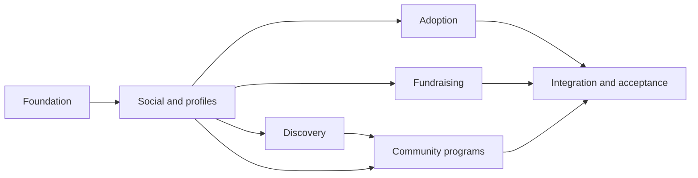

# PawTrail Full Application Implementation Plan

> **For agentic workers:** REQUIRED SUB-SKILL: Use superpowers:subagent-driven-development (recommended) or superpowers:executing-plans to implement this plan task-by-task. Steps use checkbox (`- [ ]`) syntax for tracking.

**Goal:** Deliver a functional, social-first PawTrail frontend with every discovery, adoption, fundraising, welfare, and account flow in the supplied brief.

**Architecture:** One Next.js App Router app with server-rendered public pages and focused client islands. Typed domain APIs run through request-scoped mock or Django adapters; a session-isolated, disk-backed demo repository keeps server and client reads consistent. Shared pet identities connect social activity to welfare features.

**Tech Stack:** Next.js, React, TypeScript, Tailwind, Shadcn, Lucide, TanStack Query, Zustand, React Hook Form, Zod, Motion, Recharts, Google Maps/vis.gl/MarkerClusterer; Vitest, Testing Library, axe-core, and automated Node HTTP probes.

**Spec:** [PawTrail architecture specification](../specs/2026-11-02-pawtrail-design.md); [original user brief](../../requirements/pawtrail-original-brief.txt). The spec distinguishes proposed social additions and frontend delivery from future production services.

## Global Constraints

- Frontend TypeScript and JavaScript use no semicolons.
- Public profile content remains server-rendered; Google Maps is a client island. Never use site-wide `ssr: false`.
- `NEXT_PUBLIC_USE_MOCK_API=true` is the initial mode. Samples, demo authentication, and simulated contributions are visibly identified.
- Initial currency is PHP, money is integer centavos, locale is en-PH, timezone is Asia/Manila, and demo clock is `2026-11-02T00:00:00+08:00`.
- Palette: `#F97316`, `#EA580C`, `#0F766E`, `#84CC16`, `#FFFBF5`, `#FFFFFF`, `#3B2416`, `#78716C`, `#EDE5D8`. Use contrast-safe combinations; orange need not have white foreground text.
- Canonical controls live in `src/components/ui`. Feature code must not use raw button/input/select/textarea/table primitives. Run `npm run check:ui` after frontend edits.
- No production build, visual test, browser visual inspection, or manual verification without an explicit user request. Use scoped automated tests and checks.
- No real payments, public applicant answers, exact sensitive public coordinates, invented verification, or AI medical diagnoses.
- Never modify PixelCore or the protected DineEase repository. Never commit credentials, uploads, or demo session data.

## Review Focus

1. **Session crossover and stale SSR:** a new private application or demo campaign must survive refresh without appearing in another session. F3/F4/I3/I5 pin this.
2. **Public projection leaks:** exact coordinates, applicant answers, anonymous identities, and private evidence must be absent from HTML, JSON, metadata, search, maps, and caches. F2/S1/A3/R2/I2/I5 pin this.
3. **Repeated/concurrent actions:** double-clicks, retries, role changes, and stale tabs must not duplicate donations, Kibble, applications, reactions, or RSVPs. F3/S2/A3/R2/W1/W2/W4/I3 pin this.
4. **Unavailable dependencies:** missing Maps key, blocked scripts, denied location, token expiry, malformed backend data, and timeouts must preserve usable navigation and honest feedback. F4/D2/I1/I4 pin this.
5. **Time and moderation boundaries:** month changes, deadlines, unreviewed evidence, removed posts, rejected campaigns, and hidden profiles must change visibility and actions consistently. S3/S5/A4/R3/W1/W2/W4/I2 pin this.

## Repository and file boundaries

The documentation-only repository already exists on `codex/pawtrail-planning`. F1 adds application tooling to it; do not reinitialize Git or overwrite these planning records.

```text
src/app/                      route composition, metadata, loading/error boundaries
src/app/api/v1/[...path]/      allowlisted BFF dispatch; Node runtime in local demo mode
src/components/ui/            canonical Shadcn primitives and action-link wrappers
src/components/layout/        desktop header, mobile navigation, drawers, dashboard frame
src/components/shared/        data states, money, status, image, privacy, demo components
src/components/maps/          Google provider, map canvas, markers, cluster lifecycle
src/components/illustrations/ original reusable doodle assets
src/features/<domain>/        schemas, types, components, hooks, domain rules
src/lib/api/                  client/server entry points, domain interfaces, adapters
src/lib/server/               sessions, permissions, CSRF, demo repository, private media
src/lib/seo/                  canonical URLs, metadata, JSON-LD, sitemap policy
src/data/fixtures/            deterministic public sample records and private test fixtures
src/stores/                   UI-only state
tests/unit/                   domain, adapter, projection, state, and component tests
tests/contracts/              identical behavior suite for mock and proposed Django adapters
tests/routes/                 HTTP scenarios run against next dev, without a browser
scripts/                      UI boundary guard and isolated route-test process launcher
public/images/                licensed pet photography and original doodles
docs/contracts/               proposed Django wire contract and integration expectations
.pawtrail/                    ignored runtime sessions, uploads, and demo overlays
```

Do not centralize all feature behavior in a catch-all route or a large page. The BFF registry maps explicit method/path patterns to domain services; it never owns domain state transitions. Each task below owns a reviewable outcome and its own test/commit cycle.

## Work packages and dependency order

| Package | Tasks | Depends on | Working outcome |
| --- | --- | --- | --- |
| [1. Foundation](2026-11-02-pawtrail-1-foundation.md) | F1–F7 | planning baseline | Running shell, landing, API, demo persistence, auth, uploads |
| [2. Social and profiles](2026-11-02-pawtrail-2-social.md) | S1–S5 | F1–F7 | Public pets, posting, comments, following, moderation, account workspace |
| [3. Discovery](2026-11-02-pawtrail-3-discovery.md) | D1–D5 | F1–F7, S1/S3 | Map/list, sightings, animal reports, groups, global search |
| [4. Adoption](2026-11-02-pawtrail-4-adoption.md) | A1–A4 | F1–F7, S1/S5 | Preferences, swipe/button interest, private applications, shelter review |
| [5. Fundraising](2026-11-02-pawtrail-5-fundraising.md) | R1–R4 | F1–F7, S1/S3/S5 | Campaign discovery, demo support, creation, transparent organizer tools |
| [6. Community programs](2026-11-02-pawtrail-6-programs.md) | W1–W4 | F1–F7, S1–S5, D1/D3/D4 | Evidence-reviewed help, rewards, shelters, events |
| [7. Integration and acceptance](2026-11-02-pawtrail-7-integration.md) | I1–I6 | all feature packages | Adapter contracts, complete SEO, cross-feature acceptance, CI and handoff |



This is dependency structure, not authorization to spawn implementation agents. Execute serially by default until the user selects an execution method. Build the full requested scope; do not quietly stop at the social package and call it complete. Packages are milestones, not optional cuts.

## Task protocol

Every task in the linked packages contains: exact files; interfaces consumed/produced; a failing test with concrete assertions; a command showing that failure; implementation constraints; a passing targeted verification command; and a commit checkpoint. Initial tool setup may precede the first runnable test, but behavior implementation must follow its failing test. Do not write shallow tests that merely repeat a JSX implementation.

Brace notation expands to the listed concrete paths. Type/schema files already created by F2 are extended by their owning tasks, never overwritten as unrelated new files. Assertion snippets use arranged fixtures and test-local helpers within the listed test files; those helpers are not extra application API methods. Define each helper alongside its tests. Public interfaces are the explicitly named signatures, principally spec §5.

Use `npm run test:unit -- <listed files>` for scoped work. After frontend edits also run `npm run typecheck` and `npm run check:ui`. Run format checks on changed files; run the full automated suite once at I5/I6 unless a regression justifies an earlier broad pass. Do not use a production build as a substitute for these checks.

## Script contracts

F1 creates `dev` (Next dev), `typecheck` (now `next typegen && tsc --noEmit` after the F7 generated-metadata ruling), `check:ui` (TypeScript-AST boundary scanner), `format:check` (Prettier check with `semi: false`), and `test:unit` (Vitest run). I5 creates `test:routes`, which launches an isolated Next dev process, injects a temporary demo directory and test clock, polls readiness, executes HTTP assertions, and reliably terminates the process/cleans temporary files. I6 creates `check` as the ordered automated aggregate. A conventional `build` script can exist for future explicit requests, but no task runs it and CI does not invoke it.

## Brief coverage matrix

| Original brief sections | Implementing tasks |
| --- | --- |
| 1–3 overview, stack, identity | F1/F2/F6/F7, PRODUCT.md, spec §§1–4/9 |
| 4 navigation and Create actions | F6, completed destinations D3/S2/R3/W1 |
| 5 landing and sample statistics | F7; live data previews wired at I3 |
| 6 animal map and filters | D1/D2/D3 |
| 7 public animal profiles | S1, D3, I2 |
| 8 adoption and shelter review | A1–A4 |
| 9–12 fundraising and management | R1–R4 |
| 13 missions | W1 |
| 14 rewards and leaderboard | W2 |
| 15 Hordes | D4 |
| 16 community feed | S2/S3/S4 |
| 17 public users/private dashboard | S4/S5 |
| 18 shelters and rescuer tools | W3, A4/R4/W1/W4 |
| 19 events | W4, D2 |
| 20 global search | D5 |
| 21 SEO | S1/I2 |
| 22 feature structure | F1/F2, every package |
| 23 fixture counts and API switching | F2/F3/I1 |
| 24–25 responsive UX and states | F6, every UI task, I4/I5 |
| 26 trust/privacy | F2/F4/F5, S3/S5, A3/A4, R2–R4, I2/I5 |
| 27 implementation order | reordered for social-first emphasis; all phases retained |
| 28–29 quality and final deliverables | I3–I6 and package exit criteria |

## Milestone exit criteria

**Foundation:** deterministic data, scoped auth, reload-safe demo mutations, shared controls, shell and landing work. **Social:** a member can publish a pending pet story, a moderator can review it, another demo actor can react/comment/follow, and pet/user pages reflect authorized activity. **Discovery:** search/filter/select/list/report flows work even when Google is unavailable; live map verification is separately recorded. **Adoption:** interest → private application → shelter decision works with no approval shortcut. **Fundraising:** create/review → sample contribution → update/expense history works without any claim of real money. **Programs:** accepted help → evidence → approval → one Kibble award, plus shelter/event flows. **Acceptance:** all route inventory, contracts, privacy projections, fallback states, and docs are checked.

## Environment and external dependencies

Implementation creates `.env.example` with `NEXT_PUBLIC_USE_MOCK_API=true`, `NEXT_PUBLIC_SITE_URL=http://localhost:3000`, optional `NEXT_PUBLIC_GOOGLE_MAPS_API_KEY` and `NEXT_PUBLIC_GOOGLE_MAPS_MAP_ID`, server-only `DJANGO_API_BASE_URL`, `SESSION_SECRET`, and optional `DEMO_DATA_DIR`. Do not add secret values. Browser Maps keys are public identifiers that must be restricted by origin/service; server credentials must never use `NEXT_PUBLIC_`. A missing Django origin in real mode fails configuration with a helpful message, rather than silently returning fixtures. Real payments remain off in both modes.

No actual backend, Maps credential, hosting target, or finished logo is available. Adapter conformance uses controlled HTTP fixtures. Functional Google-map loading, a real Django environment, and production deployment cannot be marked verified without those external dependencies. No GitHub repository or hosted Site is created by this planning delivery; the current repository is local.

## Plan review and execution handoff

- [x] User approved implementation of this plan on 2026-11-02.
- [x] User selected Subagent-driven execution on 2026-11-02.
- [x] Execution skills found in the existing local Superpowers package; no installation needed.
- [ ] Complete Impeccable's pre-UI direction/workflow decisions within the pinned brand; record them once.
- [ ] Execute all 35 tasks in dependency order, recording commands/results and commit IDs in the task checklists.

Native execution is recommended for this repository: the packages share many domain types and state transitions, so one implementer can keep those boundaries consistent with less context overhead. The user may prefer per-task independent review instead. The user subsequently authorized application implementation using subagents on 2026-11-02.
