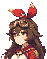
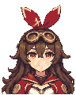
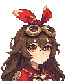
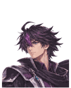

# Portrait style choice and existing examples

Read at the portrait stage of actor creation, after the animated illustration,
or when an independent portrait job has no explicit style answer. The owner's
preferred portrait is **Refined cel**. Recommend it but ask the user to choose;
the illustration's style and a previous actor's choice do not answer this job's
portrait question. An explicit current-job portrait choice already answers it.
Retain the selected style during a repair unless a style change was requested.

## Show real artwork before asking

Present the actual images inline, with the character and style named. Use
absolute local image paths in the desktop app, expanding these relative paths
against this reference file's directory. Reference the images in the same conversation
as the concise style question; a list of names alone does not show the choices.

**Amber — Refined cel (recommended), default three-quarter angle:**

**Other available Amber angles in that same style:**

**Additional style — Painterly anime fantasy, shown by Sieghart:**

The current catalogue has Amber in Refined cel, not an Amber pack in every style.
Never relabel Sieghart as Amber or claim these are different Amber styles.
For other existing style examples use their actual approved character/source in
[style contracts](style-contracts.md); disclose that another character illustrates
that option. Show additional examples when relevant, without generating a style
batch solely to ask the question. Provenance for the copied examples is stored
in `assets/style-examples/provenance.json`.

A suitable question is: “Which portrait style should [name] use? Refined cel is
recommended; Painterly anime fantasy is the smoother alternative shown above.”
Use the available user-input tool with concise options, including the recommended
choice first. Existing other styles remain available; a free-text style answer
is valid. This is a real style choice, so wait for the answer before producing
portrait artwork. Independent approved illustration/model preparation may continue
without making that choice for the user.

## Separate style and angle contracts

- Illustration: default to **Refined cel + painterly**, combining new Sieghart's
  mature painted detail/materials with old Sieg's pixel texture, cel structure
  and semi-bold stepped outlines. Keep pure
  Painterly anime fantasy available as an explicit alternative.
- Portrait: use the user's explicit answer; recommend Refined cel. Retain the
  actor's identity, costume and palette across the rendering-style difference.
- Icon: derive from the **approved normal animated illustration**, with coarser
  compact pixels and the shared woody frame/active glow. A different portrait
  style does not change this icon's source/style.
- 3D body: follow the animated illustration's construction and any needed static
  matching turnarounds, while preserving the shared game rig and renderer.

Portrait and icon default to **three-quarter**, not the first array element.
Resolve the actual three-quarter pose ID from each manifest. Front and head tilt
remain selectable for portraits; retain requested alternate icon angles as an
authoring choice, not an automatic export of every angle. Keep an explicit current
selection or saved angle. The portrait preview controls the dialogue's angle;
do not add a second angle picker inside the dialogue.

Record separate illustrationStyle, portraitStyle, portraitDefaultAngle and
iconAngle decisions in the authoring brief using the project's actual schema.
These are authoring facts, not a claim that account-save/API contracts already
accept new fields. A skill edit alone does not regenerate or replace existing
runtime portraits, icons or illustrations.
