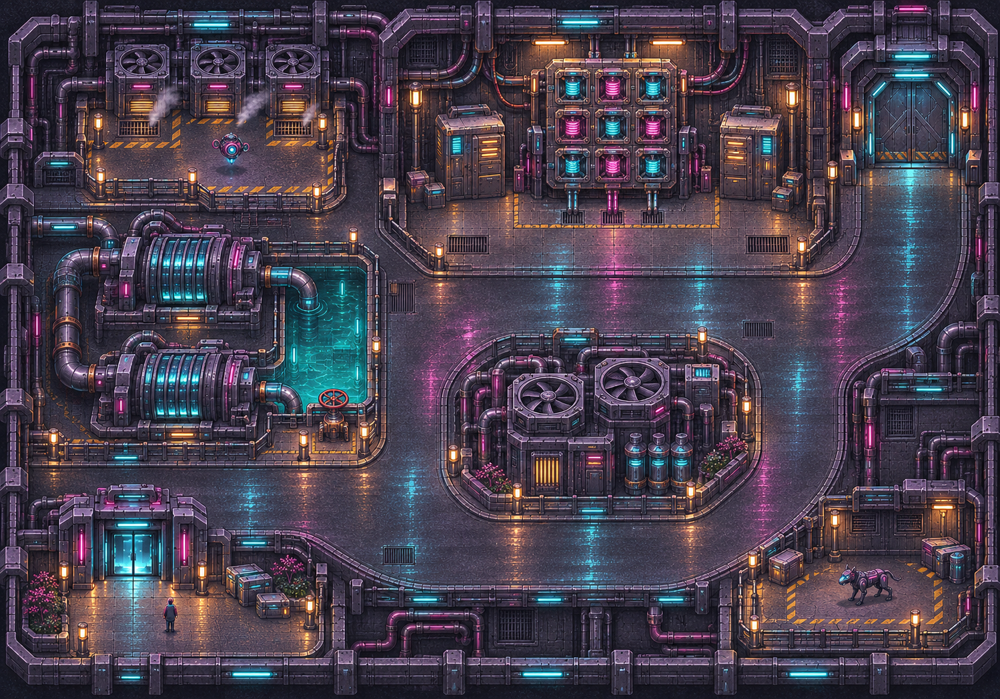
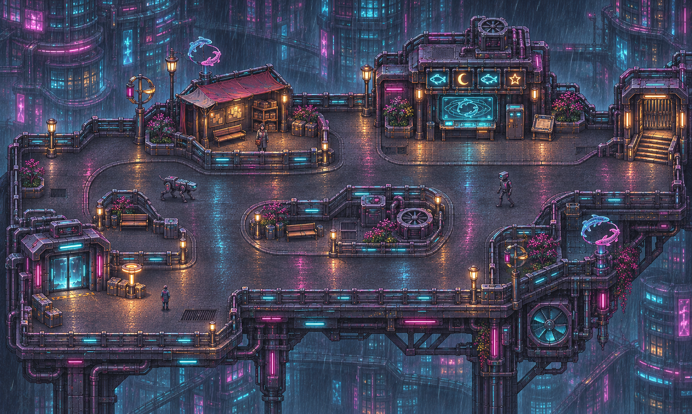

# Concepts D/E — approved

Generated on 2026-11-15 through built-in ImageGen from the approved arrival and
market concepts. These new map concepts retain the accepted cyberpunk pixel
style; they are not native atlases, editable layouts or installed world stages.

## D — Undergrid

Safe southwest market return, broad machinery loop, western pump/reservoir
gallery, northeast relay hall/service lift and two separated small machine
encounter pockets. Relay/cabinet approaches remain open. Planned animation is
localized to coolant, rotors, status lights and vents; solid structures stay put.
Exact contact/route clearance belongs to subsequent native layout authoring.

## E — Rainline Skybridge

Undergrid return lift at lower left, protected courier shelter at upper left,
archive and separate locker at upper right, clear railed promenade/side loop and
an eastern future-Switchyard threshold. All playable paths are on one continuous
plane. Planned motion includes rain/reflections, fans, holographic signal layers,
localized lights and shelter cloth. Nyx's small silhouette is scale/composition
guidance, not a final actor illustration approval.

The public archive plaque remains reachable regardless of reputation; combat
pockets stay outside the safe arrival/courier approaches. The actual Switchyard
destination remains a later installation and cannot be entered prematurely.

## Approval and source record

The owner explicitly approved both images with “Approve both concepts” on
2026-11-15. This authorizes their dependent production. No silence/default timer
was used. First-loop verification
also remains deferred; the owner's “proceed” instruction continues production
planning without claiming a test/browser pass.

Exact prompts, reference roles, original source paths and generation timestamps:
[prompts](concepts/batch-b-v1/prompts.json),
[job](concepts/batch-b-v1/job.json),
[Undergrid source](concepts/batch-b-v1/04-undergrid-v1.json),
[Rainline source](concepts/batch-b-v1/05-rainline-skybridge-v1.json).
The [Phase 4 production brief](phase-4-production-brief.md) records reuse,
missing models/art and the dependency-ordered implementation after approval.
