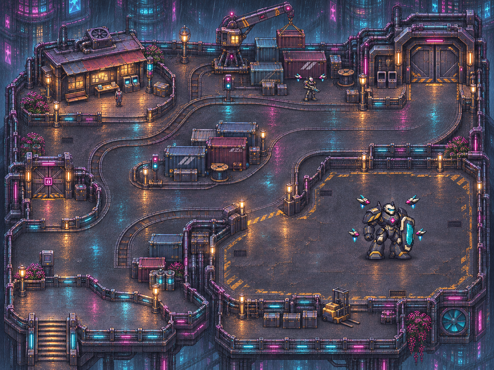

# Concept F v1 — Neon Switchyard

**Status: explicitly approved — “Approve concept F v1 — proceed.”** Generated with built-in ImageGen
from the retained Neon Heights art and existing enemy identity references.
This is a complete composition proposal, not an installed map or an asset sheet.

## Layout to approve

- **Upper left:** R10 Freight Dispatch, Sena's safe service desk, authorization
  terminal, checkpoint marker and expedition supply bin.
- **Southwest:** Rainline return landing; broad service loop leads into the yard.
- **West middle:** locked Market shortcut. Authorization opens this and the
  Bastion route together later; neither consumes keys piecemeal.
- **Lower right:** isolated R11 Marshal Dock, clear dodge space and a wide entry.
  Existing Iron Marshal stands at approximately 3.4 human heights. His four small
  decorative emitters are not the destructible-funnel mechanic.
- **Upper centre:** grouped freight cargo, restrained crane/signals and one
  optional Prism Gunner pocket with a route around it.
- **Upper right:** closed Bastion bulkhead, separate from Kurogane's actual arena.

Retain the single walkable plane, native textured 2D/cel pixel finish, restrained
colored outlines, wet graphite material values and amber safe-area lights.
The small cabin figure indicates Sena's location only; her production design and
portrait style retain the actor workflow's later review.

## Motion and production after approval

Animate localized signal lamps, fans, terminal scan/light states, crane warning
lamps and puddle reflections; architecture stays grounded. Reuse complete existing
city and machinery sources. New active terminal/gate/container assets use our
actual textured 3D route, with applicable prop-angle review before modeling.

After approval: create the approved scenery/interactive props and editable yard;
produce Sena's presentation; connect her authored scripts and Q04, real Marshal
defeat/Writ, two-key gate/shortcut authorization, and the existing Kurogane arena
handoff/loot/report. Preserve the 3,000-HP Marshal recovery-armor mechanic and
8,400-HP Kurogane body/four 360-HP funnels as separate contracts. See the
[Phase 5 brief](phase-5-production-brief.md) for dependency and save details.

A new Bastion composition or material layout deviation requires its own review;
this image does not approve unseen boss artwork. Governance/crafting remain
Phase 6. No production assets, stage layouts or game code were changed for this
concept. Tests, checks, builds and browser verification remain deferred.

[Full prompt and reference set](concepts/batch-c-v1/prompts.json) ·
[Generation and review record](concepts/batch-c-v1/job.json).
