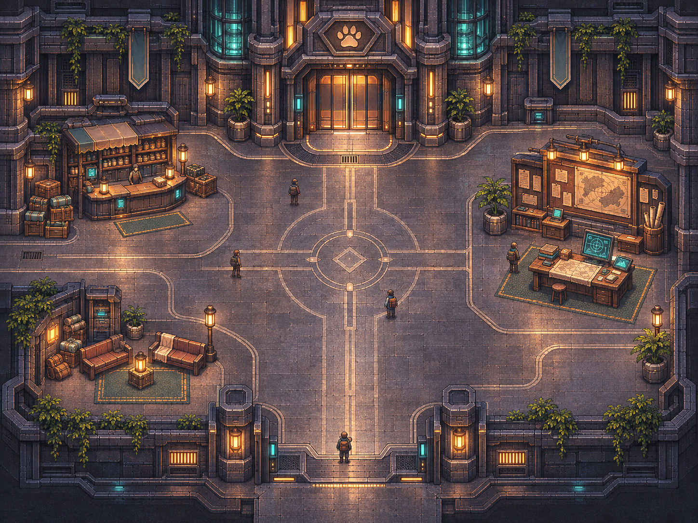
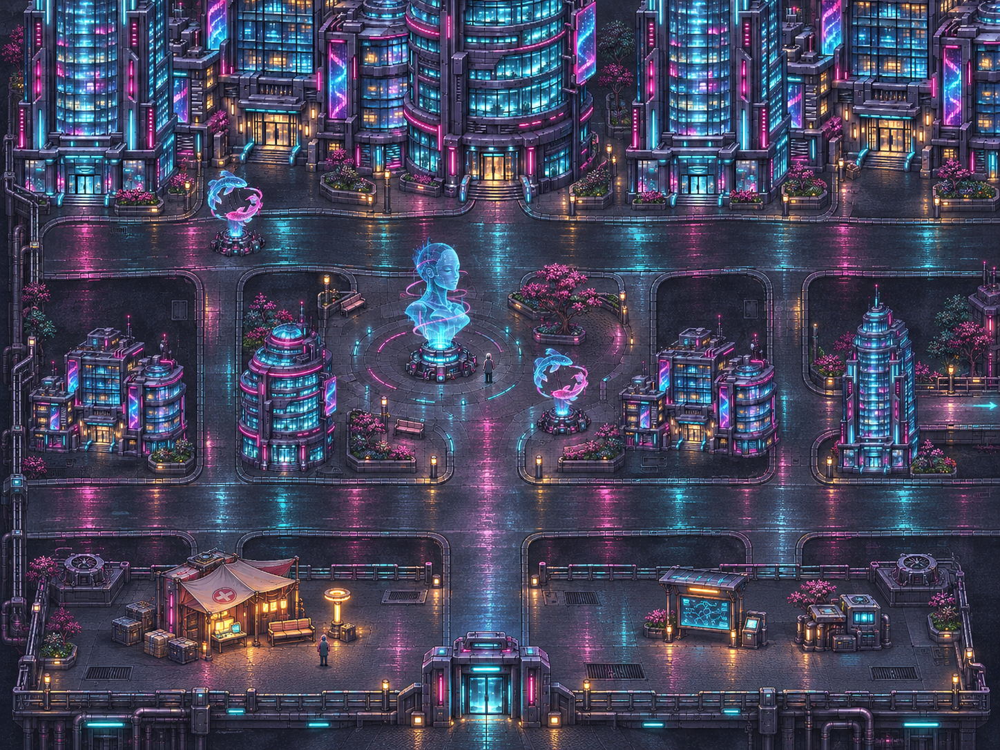
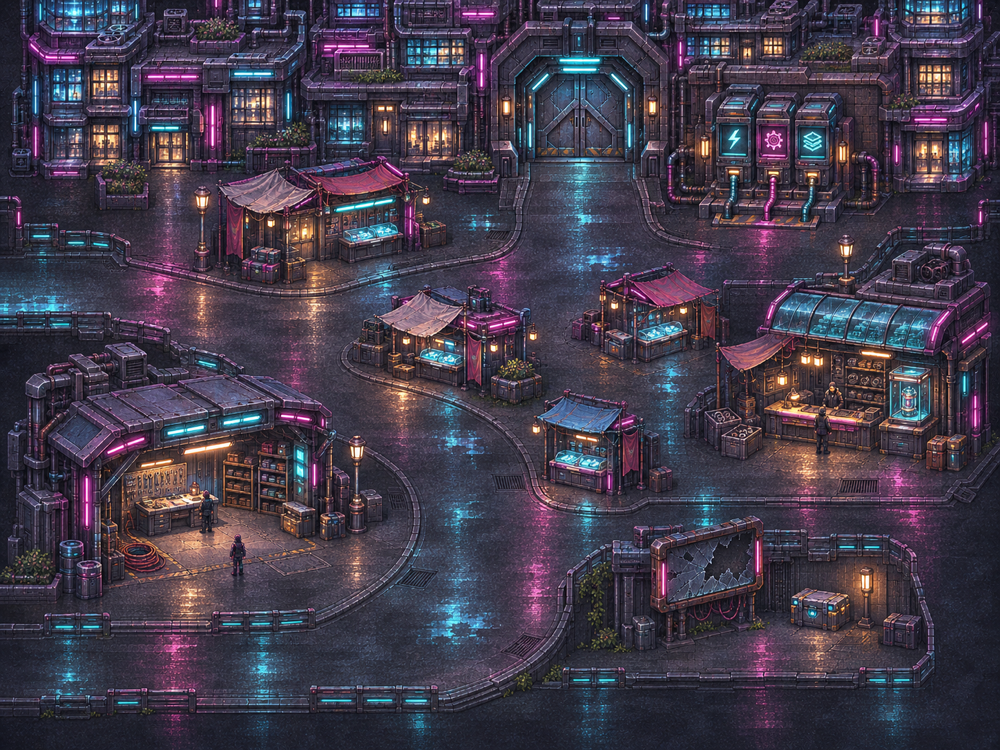

# First concept batch — approved

The owner approved all three v1 concepts on 2026-11-15 with **“Approve all three
concepts.”** This records image approval, independently of the earlier written
floor-plan approval. No silence/default timer was used. Later maps retain their
own concept gates.

## A — Wayfarer Concourse, shared tower lobby

Central upper lift; open preparation plaza; trading counter on the left;
rest/camp alcove below it; expedition board and planning desk on the right.
Warm amber and restrained teal keep this shared lobby distinct from the neon
floor. Tiny figures establish scale, not approved finished NPC designs.
Future motion: lift controls, restrained status lights and equipment displays;
structural stone/metal stays still. Facilities need real controls and outcomes.

## B — Lantern Landing and Hologram Plaza, arrival stage

Preserves the existing skyline/boulevard structure, with the southern return
lift, Mara's warm camp at lower left, route board lower right and readable
connections to the central projection plaza and eastern market exit. The terrace
remains on one physical plane. Future motion includes actual moving holograms,
localized window/sign cycles, fans and reflection overlays.

## C — Lumen Market, first connected market stage

Western arrival, northern utility gate, repair bay lower left, Ivo's salvage
counter on the right, allocation equipment near the gate and a southern cache
pocket. Maintain unobstructed approaches around the stalls. Future motion uses
localized display/light changes and machinery; canvas awnings can respond gently
without making rigid kiosks float.

## Production invariants

Images are concept references, not flattened replacement game maps or ready-made
atlases. Asset production must preserve independent terrain/scenery/model layers,
real walkable gaps, actor scale, collision, interactive 3D contacts, native frames
and runtime animation. No static concept image proves a loop is animated.

Built-in `image_gen` produced the concepts. The exact prompts and reference roles
are in [prompts.json](concepts/v1/prompts.json); each image has its source/timing
record alongside it. Original generated files are retained and the selected
images are copied into this workspace. Assets/layouts are still a separate batch.
