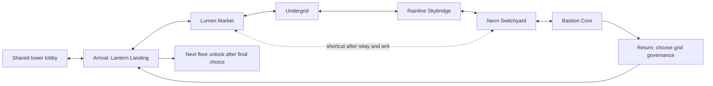

# Floor 01 — Neon Heights: The Borrowed Dawn

**Status:** floor plan approved by the owner on 2026-11-15; Phase 1 foundations
authored and first lobby/arrival/market concepts approved. Asset/layout production
and runtime verification remain separate; see [Phase 1](phase-1-runtime-contract.md)
and [approved concepts](concepts-v1.md).
**Basis:** the existing Sampaguita Neon Heights cyberpunk stage and the owner's
50-floor vision. Floor 01 is a provisional slot for the first authored floor,
not a decision that its current combat difficulty suits a new player.

Read alongside [NPC scripts](npc-scripts.md), [memory/reputation specification](npc-state-spec.md)
and [implementation phases](implementation-phases.md). All `f01.*` IDs in this
package are proposed content IDs, not registered game records. Existing `neon:*`
assets and the named Kurogane family retain their real IDs.

## 1. The floor at a glance

Neon Heights runs on borrowed electricity. Clinics, markets and transit platforms
share an aging grid, while beautiful koi projections hide the city's failing
maintenance signals. A corrupted security directive has sealed the old switchyard.
Restoring power means confronting its guardian, then deciding who should control
the repaired network. People remember whether you protected their neighbors,
exposed their dealings, kept their secrets or sold a promise.

The experience alternates between a calm, inhabited arrival district and compact
expeditions through utility spaces, elevated walkways and a deserted machine yard.
The main conflict is infrastructure and responsibility, with fictional mechanical
enemies. Community animals and platform records are outside combat and rewards.

| Decision | Proposal |
| --- | --- |
| Floor identity | `f01`, Neon Heights; chapter subtitle The Borrowed Dawn |
| Representation | Textured 2D environment; animated scenery; actual textured 3D interactive map props |
| Player | Existing selected actor, native scale; solo design for this package |
| Structure | Six local stages, twelve named rooms/pockets, one shared-lobby connection |
| Progression | Six main quests, four side quests, one repeatable supply contract |
| Activities | Four puzzles/minigames; gathering, crafting, story and optional discoveries |
| Characters | Five new NPC identities with scripted memory and reputation |
| Encounters | Three existing normal machines, Iron Marshal, existing Kurogane boss |
| Local currency | Proposed Circuit Scrip, abbreviated SC; separate from Kibble |
| Ending | Three power-governance choices; each permits tower advancement |

**Art direction.** Preserve the current cyan/magenta skyline, graphite pavement,
fine textured pixel detail and readable colored shadows. Keep dense architecture
around navigable streets; quiet floor surfaces support actor readability. The
city remains luminous without a full-screen bloom or dark filter on the player/HUD.
New maps need their own generated concept approval before production.

**Motion direction.** Koi swim and turn, the android projection has restrained
head/scan motion, windows and signs change locally, fans turn, and sparse reflected
light travels over pavement. Rigid buildings and railings stay grounded. Loops
are staggered between instances. Reduced motion substitutes steady light and
low-motion poses while preserving readable action outcomes.

## 2. What exists and what is proposed

The current [stage preview](http://127.0.0.1:3000/play?preview=stage&map=cyberpunk)
is the source for the **arrival district**, not an already-installed floor.

| Existing source | Reuse and limit |
| --- | --- |
| `src/game/stage-editor/maps/neon-heights-v1.json` | 48 × 36 editable stage, eleven tower blocks and 34 scenery objects; preserve this original |
| `src/game/stage-editor/neon-art.json` | Continuous ground, eight base props, three large tower variants; current artwork is static |
| `assets/maps/neon-heights-v1/` | Reference, sources, provenance and native overview; art inspection is not live gameplay approval |
| Stage editor canvas/playtest | Local walking, collision, depth, actor selection and furniture actions; not a connected floor/portal system |
| `src/game/systems/quests.ts` | Existing local quest event/count/claim foundations; needs floor content and richer conditional effects |
| `src/game/systems/save.ts`, `types.ts` | Version-two neighborhood save and simple relationships; current scene union lacks these floor stages |
| `src/components/game/dialogue.tsx` and shared dialogue HUD | Presentation/choices to reuse; no claim that the planned NPC memory graph exists |
| Kurogane profile and robot/family encounter code | Existing original machine art, mechanics and preview contracts; floor spawns, drops and quest integration are new |

New engineering includes floor transitions/checkpoints, local floor-state
persistence, conditional narrative scripts, knowledge/reputation, scoped loot
and inventory/economy, puzzle controllers and animated-map asset consumption.
The 3D interactive-prop renderer integration is a real unresolved dependency:
the existing stage canvas renders sprites. A source GLB beside a static sprite
will not count as live interactive 3D. Phase 1 resolves the renderer contract.
No runtime, database, asset, save or current preview is changed by this package.

## 3. Lobby, arrival and preparation

**Planning assumption:** a shared, neutral **Wayfarer Concourse** (`hub.concourse`)
serves all 50 floors. This is not an existing map or a commissioned design for
the other 49 floors. Each floor gets its own arrival/camp where its story needs it.

| Facility | Trigger and information | Action/result and failure |
| --- | --- | --- |
| Tower lift | Interact; floors show name, available/locked/cleared state and explicit prerequisites | Enter an unlocked destination after load; failure keeps player safely in hub; no false successful travel |
| Expedition board | Open a floor card; tracked main/side quests, preparation notes, active checkpoint | Track an objective or resume floor; missing requirements are explained |
| Shared planning desk | Inspect inventory, recipes and the known route | Pin a recipe/objective; future unknown rooms remain silhouettes |
| Rest station | Free rest outside combat | Restore local HP to 100; show actual restoration; never require currency to recover |
| Save/travel confirmation | Exit floor or start a fresh expedition | Explain what resets; write state before transition; failed write offers retry/cancel |

**Neon Heights local camp:** the current lower maintenance terrace becomes
**Lantern Landing**, with Mara's aid bench, a small planning board and a return
lift. Start around the current arrival `(768,1088)` at native scale; determine
actual new prop positions from actor clearance rather than treating these
coordinates as approved collision geometry. This is one walkable ground plane.
No rooftop jumping/multilevel physics is implied by the terrace artwork.

The arrival plaza and camp are always safe. Rest is free. The shop's stock and
quest items are available without positive reputation. Returning to camp doesn't
respawn enemies or regrant supplies. Shared-lobby entry starts an expedition;
the player can resume its checkpoint or explicitly start a new one after seeing
the reset summary. Clear-state rematches use the same rule.

Panels use real shared shadcn/HUD controls, Saira Condensed headings and Instrument
Sans body text. The popups contain live text, meaningful buttons, focus/close
behavior and pending/blocked/success states. No text is baked into art.

## 4. Connected stages and ecosystem

| Stage ID | Proposed size | Role, entries and encounters |
| --- | --- | --- |
| `f01.stage.arrival` | Existing 48 × 36 | Lantern Landing and Hologram Plaza; hub return south, market passage east; safe, Mara/EKO-9, two koi emitters |
| `f01.stage.market` | 32 × 28 | Lumen Market; Ivo's stall and repair bay; arrival west, utility gate north; safe streets, optional noncombat discoveries |
| `f01.stage.undergrid` | 40 × 28 | Pumps and relay corridors; market hatch, skybridge service lift; one or two normal enemies per authored pocket |
| `f01.stage.skybridge` | 40 × 24 | Rainline maintenance walkway; Nyx's courier shelter and archive locker; undergrid lift, switchyard stairs; two short patrol pockets |
| `f01.stage.switchyard` | 36 × 28 | Deserted freight infrastructure; Sena's safe gate cabin, Iron Marshal dock; bridge entry, later market shortcut, boss gate |
| `f01.stage.bastion` | Arena-specific | Existing Kurogane fixed-three-quarter arena contract adapted to floor entry/return; tile footprint and coordinate conversion require concept/integration review |

Sizes for new maps are proposals. Only one active stage and its bounded transition
neighbors load. Every gate has a walkable return and every checkpoint is outside
damage zones. New entrances/return spawn points need authored collision review.

### Rooms and discoveries

| Room | Stage | Content and result |
| --- | --- | --- |
| `f01.room.r01` Lantern Landing | Arrival | Free rest, Mara, return lift, route board; persistent camp checkpoint |
| `f01.room.r02` Hologram Plaza | Arrival | EKO-9, koi P04, public ending controller after boss; no combat |
| `f01.room.r03` Merchant Lane | Market | Ivo, free quest cell, P01 allocation board, invoice service |
| `f01.room.r04` Repair Bay | Market | Q07 awning repair, crafting station, first-only toolkit: Fiber 4 + Wire 2 |
| `f01.room.r05` Dead Advertisement | Market | Optional readable sign clue opens first-only cache: Wire 2 + Prism 1 |
| `f01.room.r06` Pump Gallery | Undergrid | Arc Wisp pocket, coolant vent hazard, reservoir: Coolant 3 per expedition |
| `f01.room.r07` Relay Hall | Undergrid | P02 circuit puzzle, guaranteed Relay Seal; cable cabinets: Wire 2 each, two cabinets per expedition |
| `f01.room.r08` Rainline Walk | Skybridge | Rivet Hound/Prism Gunner pockets, Nyx and safe courier alcove |
| `f01.room.r09` Signal Archive | Skybridge | P03, guaranteed Memory Fragment and Invoice Record; separate first-only locker: SC 20 + Prism 1 |
| `f01.room.r10` Freight Dispatch | Switchyard | Sena's safe cabin, boss/checkpoint explanation; supply bin: Scrap 4 + Fiber 2 per expedition |
| `f01.room.r11` Marshal Dock | Switchyard | Iron Marshal, guaranteed first Transit Writ; no trash enemies added during his fight |
| `f01.room.r12` Bastion Core | Bastion | Kurogane and four funnels; confirmed victory receipt, return exit; no additional mob wave |

R05's sign clue says to inspect its unlit maintenance panel, not shoot random
walls. R09's optional locker has a public maintenance code on its nearby service
plaque; Nyx can point to it but reputation never makes it unobtainable. First-only
room rewards use profile-scoped claims; reservoir/cabinet/bin claims use expedition
scope. The Memory Fragment and quest seals cannot be sold or crafted away.

### Why this ecosystem works

The Exchange moves salvage and keeps stalls supplied. Residents maintain rain
collectors, clinics and cloth awnings. Grid Wardens keep service corridors open
but rely on obsolete machines. Free Runners carry messages over the Rainline.
EKO-9 preserves civic route records through projector fragments. Coolant and
wire travel from maintenance spaces to repair/crafting; reclaimed alloys return
from hostile machines to the camp's furniture economy.

Kurogane and its units are repurposed transit/security machines, not supernatural
animals. Their corrupted perimeter instruction explains hostile pockets in the
otherwise inhabited city. Their defeat clears immediate routes; a rematch is
explicitly a local simulation after the story clear, not a claim that the same
citizens must relive the blackout. This package proposes authored spawns and
state changes, not a full autonomous economy/population simulation.

### Hazards and recovery

Undergrid leaking vents telegraph a striped, labeled cell for 1.5 seconds before
one 10-HP electrical contact. A single vent cycle can't damage every render frame.
Skybridge warning lanes use the same visible shape contract and a 10-HP contact,
with safe waiting alcoves. No fall-to-death input trap is required. Insulators
halve two environmental contacts; they do not alter boss attack damage.
After death, return to the latest safe checkpoint at 100 HP, retain quests,
inventory/SC and decisions, reset the unfinished encounter, and discard its
uncommitted reward event. No corpse run or permanent NPC hostility blocks recovery.

## 5. Whole-floor asset and animation brief

This is a production inventory; no listed new art/model has been generated.
Native frames/counts will come from actual exports, not estimates in this plan.

| Family / proposed package | Reuse or new work | Representation, animation and owning skill |
| --- | --- | --- |
| `f01.asset.city-kit` | Existing `neon:terrain`, spire/arc/habitat and large variants | 2D bodies; new small localized window/sign/reflection layers, staggered clocks; PawTrail Assets |
| `f01.asset.projections` | Existing `neon:holo-head`, `neon:holo-koi` source identity | Animated projection/head/fin/scan layers; grounded base; new NPC performance package for EKO-9 |
| `f01.asset.street-kit` | Existing HVAC/railing/kiosk scenery | Fan rotor, rail glint, kiosk display cycle; preserve rigid geometry; 2D ambient packages |
| `f01.asset.market-kit` | New awnings, repair-bay facade, cable supplies and weathered glyph signs | 2D cloth/lighting motion; transparent scenery; styles derived from existing city art |
| `f01.asset.utility-kit` | New pumps, insulated pipe walls, puddle edges, relay cabinets | Ambient 2D where passive; vents/effects animate; no repeating square editor grid |
| `f01.asset.transit-kit` | New skybridge sections, safe alcove, freight doors, rails and dispatch landmark | 2D structural scenery with restrained reflection/light layers; separate actual portals |
| `f01.prop.lift` | New shared lift/return control | Actual textured 3D, open/closed/pending/error states; actor-safe approach; Assets + Furniture |
| `f01.prop.camp-bench` | Reuse suitable approved 3D chair/bench family when matched | Actual 3D, seat contacts/occupancy, clothing allowance, four promised facings and above-object rotation control |
| `f01.prop.relay-board` | New reusable switch/door-control body | Actual 3D with switch/cable/emissive states; used for P01/P02 and final controller variants |
| `f01.prop.archive-locker` | New interactable source model | Actual 3D, open/close, claim/empty state; real collider and no art-only opening |
| `f01.prop.crafting-bay` | New usable station | Actual 3D with work/ready/error state; accepted crafting event drives result |
| `f01.prop.koi-lamp`, `f01.prop.bastion-bench` | New optional recipe outputs | Actual textured 3D emitter/bench; animated projection or actual sit; crafting not required for clear |
| `f01.asset.npcs` | Five new identities; reuse actor rig/performance tooling | Mara, Ivo, EKO-9, Nyx, Sena; native actor pipeline and dialogue portraits; per-scene script cues; voices deferred |
| `f01.asset.enemy-family` | Existing Rivet Hound, Prism Gunner, Arc Wisp, Iron Marshal, Kurogane | Preserve existing articulated 2D/arena representation; Monsters skill handles required missing motions/integration |
| `f01.asset.feedback` | Reuse approved contact/VFX/UI components | Confirmed sparks/slash impacts, damage numbers, blocked shield, puzzle routing, item/reputation receipts; no fake successful outcomes |
| `f01.asset.icons` | New SC/material/quest/recipe/item icons as needed | Consistent transparent pixel icons; runtime text remains HTML |

The actual NPC emitter and usable kiosk can share source silhouettes with scenery,
but existing static sprite IDs must not silently become model IDs. Author explicit
model variants. Map approval doesn't approve unknown model sides: retain required
specialist angle reviews. Full 3D maps, cloud model services, a new editor and
regeneration of unrelated actors/furniture are outside this proposal.

## 6. Quests and decisions

Quest states are available → active → completed → claimed. Accepted world facts
can satisfy later-tracked objectives where appropriate; a required conversation
still needs a new interaction. Main-path keys and story facts persist after death.
Each event and claim is guarded once per stated scope. NPC score changes are
defined centrally in [the state specification](npc-state-spec.md).

| ID / title | Giver, prerequisites | Ordered objectives and exact completion | Reward / repeat rule |
| --- | --- | --- | --- |
| `f01.q01` Find Your Footing | Mara; first floor entry | Meet Mara, activate Landing checkpoint, inspect market route; all three accepted events | SC 15, Q02 available; once per save |
| `f01.q02` Keep One Light On | Mara; Q01 claimed | Receive Ivo's free Emergency Cell, solve P01, commit Clinic or Transit allocation, return to Mara | SC 35; both choices unlock utility gate; once |
| `f01.q03` Ghosts in the Glass | EKO-9; Q02 claimed | Reach R09, solve P03, recover fragment and Invoice Record, return; choose redacted archive or erase private routes | SC 45; both retain non-private gate header and satisfy Q03; once |
| `f01.q04` Open the Dead Line | Sena; Q03 claimed | Solve P02 for Relay Seal, defeat Iron Marshal for Transit Writ, authenticate both at Sena's gate terminal | SC 60; consume seals once, open shortcut + boss gate; once |
| `f01.q05` The Neon Bastion | Sena; Q04 claimed | Enter arena, destroy four funnels, defeat Kurogane; receipt must be an accepted live encounter defeat, then report to Sena | Story victory record; SC/materials only from boss loot, not this claim; once |
| `f01.q06` Who Owns the Dawn | EKO-9; Q05 claimed | Commit Community, Warden or Exchange governance at R02 controller; consume first-clear Clearance Core | SC 80, floor cleared, next-floor eligibility and selected service perk; once |
| `f01.q07` Rainproof Neighbors | Mara; Q02 claimed | Deliver Fiber 3 + Scrap 2 to repair bay, confirm awning repair, report | SC 30; Residents +4, Mara +3; once; no main gate |
| `f01.q08` An Honest Invoice | Ivo; Q03 claimed + Invoice Record | Discuss the ledger; choose private protection or public release; accepted choice resolves the quest | SC 40 either branch; different memory/reputation; once |
| `f01.q09` Return Signal | Nyx; first talk in R08 | Accept or decline delivery. If accepted, take one Keepsake and deliver to Mara; selling instead records broken promise and changes ending of this side story | Return: SC 30 + trust; decline: no quest reward; sale: vendor SC 40, no quest reward. Recovery branch restores access, no extra currency; once |
| `f01.q10` Two Koi, One Signal | EKO-9; Q03 claimed | Complete P04 in normal or assisted mode, report the exact success event | SC 20, Koi Lamp recipe unlocked, EKO +3; once |
| `f01.q11` Maintenance Run | Sena; Q06 claimed | Deliver Scrap 2 + Coolant 1; consume only on successful turn-in | SC 12, no reputation; once per fresh expedition; optional resource sink |

Quests can be tracked without accepting scarce side resources. Q07/Q09 are
optional; no failed promise prevents Q04, a shop purchase or a later floor.
Q09's Keepsake is explicitly sellable after a narrative confirmation; main quest
keys are not. The sale warning says the courier registry will notify Nyx.
Its reconciliation branch costs Wire 3 or SC 40 for a replacement housing,
delivered to Nyx; it does not pretend the original Keepsake was returned.

### Major decisions and later outcomes

| Decision ID | Choices | Immediate and remembered consequences |
| --- | --- | --- |
| `f01.decision.allocation` | Clinic / Transit | Mara or courier NPCs acknowledge the allocation; main gate remains open in both cases; city signs show the actual powered service |
| `f01.decision.archive` | Redacted archive / Erase private routes | EKO remembers how you treated civic memory; private routes never become public; signed transit header retained both ways |
| `f01.decision.invoice` | Protect Ivo / Publish the invoice | Ivo's trust and Exchange/Residents standing differ; published choice is a public fact; no critical service denied |
| `f01.decision.promise` | Decline / Accept → Return, Sell or Reconcile | Nyx distinguishes honesty, kept promise and known betrayal; reconciliation preserves the betrayal history |
| `f01.decision.governance` | Community / Warden / Exchange | Public floor-ending record, dialogue callbacks and one service perk; every branch permits advancement |

Governance perks, claimable at most once per expedition: Community gives one
Med Patch from Mara; Warden gives one Insulator from Sena; Exchange grants a 10%
basic-shop discount rather than a free item. Ivo's personal-friendly discount is
another 10%; combined discounts cap at 20%. Core quest goods, Keepsake sale and
fixed recipe costs never receive discounts. No governance choice changes the
already-defeated boss or grants authoritative platform currency.

## 7. Materials, items, recipes and shops

### Resource dictionary

| Proposed item ID | Label / source | Use |
| --- | --- | --- |
| `f01.item.scrip` | Circuit Scrip (SC); quests, fixed caches and encounter loot | Local shop, reconciliation alternative; not Kibble or money |
| `f01.mat.scrap` | Alloy Scrap; all machines and R10 bin | Repairs, recipe bodies, Maintenance Run |
| `f01.mat.wire` | Copper Wire; R07 cabinets, R04/R05, loot bonuses | Insulator, Koi Lamp, reconciliation alternative |
| `f01.mat.coolant` | Coolant Gel; R06 reservoir, drone/marshal drops | Med Patch, Insulator, Maintenance Run |
| `f01.mat.fiber` | Weatherweave Fiber; R04 toolkit, R10 bin | Awning quest, Med Patch, Bastion Bench |
| `f01.mat.prism` | Prism Shard; R05/R09 fixed caches and specified loot | Koi Lamp |
| `f01.mat.alloy` | Bastion Alloy; Marshal/boss guaranteed drops | Bastion Bench |
| `f01.key.cell` | Emergency Cell; Ivo's free Q02 provision | P01 allocation only; cannot sell/discard |
| `f01.key.fragment` | Memory Fragment; guaranteed P03 completion | Q03 resolution; protected record remains after turn-in |
| `f01.key.relay` | Relay Seal; guaranteed P02 completion | Q04 gate authorization; cannot sell/discard |
| `f01.key.writ` | Transit Writ; first real Marshal defeat | Q04 gate authorization; cannot sell/discard |
| `f01.key.core` | Clearance Core; first real boss defeat | Q06 governance confirmation; cannot sell/discard |
| `f01.item.keepsake` | Nyx's Keepsake; accepted Q09 promise | Return or explicitly sell; unique item and persistent outcome |
| `f01.item.replacement` | Replacement Housing; Ivo's fixed recovery service after a registered sale | Deliver to Nyx for reconciliation; unique, cannot sell/craft/discard; missing-item recovery uses its original receipt |
| `f01.item.med-patch` | Crafted/bought or Community perk | Restore up to 30 actual HP outside dialogue; show applied healing; no use at full HP |
| `f01.item.insulator` | Crafted/bought or Warden perk | Halve next two environmental 10-HP contacts to 5; no stacking or boss protection |
| `f01.item.koi-lamp` | Crafted placed cosmetic | Camp projection on/off interaction; no quest power or reward |
| `f01.item.bastion-bench` | Crafted furniture | Real sit/stand with actor fit and rotation; optional clear trophy |

Invoice Record is a story fact `f01.fact.invoice-found`, not another sellable
material. Floor clear, recipe unlocks and next-floor access are flags, not items
that can be duplicated in an inventory. Normal resource quantities stack; unique
keys retain a receipt when consumed. Essential overflow goes to local recovery
storage, never onto an unreachable floor tile. Final capacity rules need review.

### Recipes

| Recipe ID | Inputs | Output and requirement |
| --- | --- | --- |
| `f01.recipe.med` | Fiber 2 + Coolant 1 | Med Patch 1; repair bay, no SC fee |
| `f01.recipe.insulator` | Wire 3 + Coolant 1 + Scrap 2 | Insulator 1; repair bay; two-contact duration, no stacking |
| `f01.recipe.koi` | Prism 2 + Wire 2 + Scrap 3 | Koi Lamp 1; Q10 recipe unlock |
| `f01.recipe.bench` | Alloy 4 + Scrap 6 + Fiber 4 | Bastion Bench 1; Q06 clear required |

Craft completion consumes inputs and grants output together once. Cancel/failure
consumes nothing. All materials have a sink; no crafting or optional furniture
is required to reach the boss. The two first-only Prism caches guarantee one
Koi Lamp recipe without random enemy drops. Additional prisms remain optional.

### Ivo's shop

Initial floor entry grants a proposed SC 30 once per save, marked local. Basic
stock restocks per fresh expedition; reloading or resting does not restock it.

| Item | Base buy / sell | Stock per expedition |
| --- | --- | --- |
| Med Patch | Buy SC 12; no resale | 3 |
| Insulator | Buy SC 18; no resale | 2 |
| Scrap | Buy SC 3 / sell SC 1 per unit | 6 |
| Wire | Buy SC 6 / sell SC 2 per unit | 4 |
| Coolant | Buy SC 8 / sell SC 3 per unit | 3 |
| Fiber | Buy SC 4 / sell SC 1 per unit | 6 |
| Prism / Alloy | No floor-one shop trade | Earn from stated sources |
| Replacement housing | SC 40 or Wire 3; fixed price | One, only for sold-Keepsake recovery |
| Keepsake | Ivo buys once for SC 40 after explicit confirmation | Unique story transaction, never ordinary quick-sell |

For Ivo trust at least 10, basic buy prices receive 10% off. Trust at most -10
adds 10% to basic buy prices; otherwise base prices apply. Ending discount stacks
additively with personal discount to maximum 20%; compute `ceil(base × factor)`.
Trust surcharge and Exchange ending discount cancel to base. Sell prices, quest
items and replacement housing are fixed. The cost-free camp and guaranteed keys
remain accessible at every reputation tier. All numbers are untested proposals.

## 8. Puzzles and minigames

| ID | Rules, solution and outcome | Failure, hints and scope |
| --- | --- | --- |
| `f01.p01` Load for the Living | R03. Auxiliary capacity 6: safety controller uses 2, Clinic and Transit each use 4. Connect controller plus exactly one service, preview the route, then confirm allocation and consume Cell. Both valid routes satisfy Q02's routing objective; Mara's report still closes the quest | Overload rejects preview, shows 10 > 6 and consumes nothing. Labels, numbers and icons supplement cyan/magenta. Choice can be revised until confirmation, then persists |
| `f01.p02` Blackout Circuit | R07. Rotate five fixed tiles on a 3 × 3 board. Source west of (row2,col1), output east of (row2,col3). Solution: (2,1) W–E; (2,2) W–N; (1,2) S–E; (1,3) W–S; (2,3) N–E. Other cells are blocked. Accepted energized path grants Relay Seal once | Wrong path trips a harmless breaker; board stays editable, no materials/HP consumed. Trace highlight and named ports provide hints. Back/leave preserves rotations; output can be re-inspected without another seal |
| `f01.p03` Mirror Archive | R09. Watch/replay paired projections, then enter Fish → Moon → Fish → Star using labeled symbol controls. Success opens the private archive and yields Fragment + Invoice Record; privacy choice occurs later with EKO | Unlimited replay and untimed entry; wrong answer resets only sequence input. Text transcript exposes the same clue. Both archive policy branches preserve required gate header |
| `f01.p04` Koi Signal Echo | R02 after Q03. Repeat the displayed four-step route Left → Up → Right → Down. Normal mode follows visible beats; assisted mode lets the player step at their own pace. Same completion and Q10 reward | No resource loss or reputation penalty; retry/reset/exit any time. No color-only or audio-only clue. Repeated successes don't repeat the once-only reward |

P01/P02/P03 are different controls on a reusable real interaction layer, not
three unrelated editor applications. A puzzle is complete only when its accepted
state opens the intended target and updates its real quest event. Disconnected
wire animation or a celebratory toast is not enough.

## 9. NPC roster, knowledge and story

| Proposed NPC ID | Identity, stage and values | What this character remembers |
| --- | --- | --- |
| `f01.npc.mara` | Mara Solis, field medic, R01; Lantern Residents; practical warmth, protects vulnerable people | Clinic/transit allocation, awning repair, whether Nyx's Keepsake was actually delivered, public governance |
| `f01.npc.ivo` | Ivo Mercado, salvage merchant, R03; Neon Exchange; values discretion and honest bargains, dislikes public humiliation | Invoice protection/publication, Keepsake sale, replacement service, public governance |
| `f01.npc.eko` | EKO-9, civic archive projection, R02; values consent and preserving useful memory; no numeric Archive faction | Private archive policy, accepted Koi calibration, public governance; no knowledge of private merchant choices unless told/public |
| `f01.npc.nyx` | Nyx Tal, Free Runner courier, R08; values clear promises over flattery | Offered/declined/kept/sold/reconciled Keepsake promise; allocation broadcast, governance; betrayal learned through defined courier receipt |
| `f01.npc.sena` | Sena Valez, Grid Warden at R10; cautious, procedural, open to evidence | Relay/writ authentication, boss victory receipt and public governance; no automatic private-archive knowledge |

The new identities are proposals, not additions to the current actor roster.
Relationships and faction scores use separate state. A merchant may know public
standing at first meeting without pretending to remember a personal conversation.
The five authored decision arcs and exact score changes are in the companion
scripts/state document, including priority, fallback and repeat lines. Scripts
use restrained emotion/performance cues; no voices are commissioned here.

## 10. Mobs, boss and drop tables

### Existing family to reuse

The current Kurogane source describes a deserted neon transit yard with corrupted
perimeter instructions. That is the foundation of this floor's hostile switchyard;
the inhabited market/arrival districts are outside its old boundary. We reuse
the source identities, silhouettes and authored mechanics rather than invent
near-duplicates. These are existing preview stats, not floor-balance approval.

| Existing ID | Habitat / role | Existing HP and counterplay |
| --- | --- | --- |
| `rivet-hound` | Undergrid/Skybridge; low quadruped pursuit machine | 360 HP; Rivet Lunge telegraphs 950 ms, 12 damage; sidestep then recovery counter |
| `prism-gunner` | Skybridge/Switchyard; ranged route denial | 400 HP; Prism Mark 1,400 ms warning, 14 damage; leave locked disk and close during recovery |
| `arc-wisp` | Pump/relay spaces; electrical maintenance drone | 280 HP; Arc Pulse 1,200 ms warning, 11 damage; clear center or outside ring |
| `iron-marshal` | R11; mandatory miniboss that issues Transit Writ on defeat | 6 bars × 500 = 3,000 HP; normal armor ×0.8, recovery ×1.5; enrage at 30%; Riot Sweep 23 / Siege Lock 25 damage; no destructible-funnel gate |

Normal units have existing recovery weakness ×1.5. Floor spawn groups begin at
one or two units, with no stacked AoE covering the whole safe route. Neither
humans nor real animals become farming targets. Spawns, patrols and multi-enemy
behavior need floor integration; current family previews don't prove this works.

### Kurogane — The Neon Bastion

**Existing ID:** `kurogane-neon-bastion`; proposed floor reference `f01.encounter.bastion`.
Kurogane once used four remote funnels to guide freight. A corrupted command
turned navigation into an exclusion grid. It guards the maintenance authority
needed to return reliable power to the people above.

Preserve the existing giant silhouette: approximately 7.5 player-height authored
world envelope, without shrinking the actor. Preserve its native articulated
2D fixed-three-quarter arena presentation; interactive scenery's 3D rule does
not silently convert this established creature representation.

- Main body: **14 bars × 600 HP = 8,400 HP**.
- Four independent funnels: **360 HP each**, an additional 1,440 component HP.
- Any surviving funnel blocks body damage. The four funnels, not painted scenery,
  are the gate. Destroyed funnels stay down until encounter reset.
- Shield down: normal body damage ×1; accepted recovery hit ×1.5.
- At 30% body HP (2,520), Overclock Siege changes artwork/pattern and triggers
  its actual one-shot phase transition. Existing enlarged beams/five-disk pattern
  remain; no new attack system is promised by this design.

| Existing attack | Warning / active / recovery | Damage and response |
| --- | --- | --- |
| Crossfire Lattice | 1,500 / 420 / 1,900 ms | 20 HP; funnels lock lanes, sidestep before fire |
| Reactor Sweep | 1,600 / 400 / 2,100 ms | 26 HP; leave marked sector or circle the body |
| Neon Lockdown | 1,800 / 450 / 2,200 ms | 24 HP; three ground-locked disks, five in Overclock; find gaps |

Telegraph geometry and accepted damage must share the same definition. Accepted
hits use contact sprites at the actual body/component plus applied damage.
Blocked body attacks show shield rejection, not successful damage. Defeat clears
hazards and creates one accepted encounter receipt; reset restores HP, funnels,
phase and cooldowns and must not grant drops. Existing documentation reports
partial prior preview evidence; this plan runs no new tests and does not declare
full defeat, floor integration or balance verified.

### Drop semantics

Each accepted encounter defeat grants one bundle per spawn/encounter instance
in the current expedition. Base entries below are guaranteed, with integer ranges
uniform and inclusive. A named bonus table is **one weighted exclusive roll**;
its listed probabilities total 100%. Containers/quest claims have their own
scopes. No drops come from pause, reset, preview defeat controls or repeated
delivery of the same receipt. Rewards go into the local inventory atomically;
presentation queues may animate them afterward without granting again.

| Table ID / source | Guaranteed entries | One exclusive bonus roll |
| --- | --- | --- |
| `f01.loot.hound` / Rivet Hound | SC 2–4; Scrap 1–2 | Wire 1: 35%; nothing: 65% |
| `f01.loot.gunner` / Prism Gunner | SC 2–4; Scrap 1–2 | Wire 1: 45%; Prism 1: 15%; nothing: 40% |
| `f01.loot.wisp` / Arc Wisp | SC 2–4; Scrap 1–2 | Coolant 1: 50%; Wire 1: 20%; nothing: 30% |
| `f01.loot.marshal` / Iron Marshal | SC 35 on first profile clear, SC 25 later; Alloy 2; Coolant 2; Transit Writ only if its story receipt is not yet recorded | Prism 1: 25%; nothing: 75% |
| `f01.loot.bastion` / Kurogane | First profile clear: SC 120, Alloy 4, Clearance Core 1 and Bastion emblem cosmetic flag. Later rematch: SC 50, Alloy 2, no unique core/emblem | Prism 2: 40%; Wire 3: 35%; Coolant 3: 25% |

The first boss receipt, inventory grant and first-clear flags commit together.
If essential-key delivery fails, hold the accepted grant in recovery storage
and allow retry, never spawn another first-clear drop or force another defeat.
Quest-critical keys are guaranteed, so drop luck cannot stop progression. Random
resource drops are supplemental to fixed sources and the cost-free recovery path.

## 11. Progression, persistence and endings

**Main route:** Q01 → Q02 → Q03 → Q04 → Q05 → Q06. Physical exploration can
reach the Undergrid/Skybridge before tracking every quest, but the boss gate
requires the authenticated Q04 seals. Facts obtained early reconcile later;
turn-ins and final decisions still require their explicit interaction.

After victory, EKO-9 presents three governance choices at R02. The controller
shows beneficiaries and the service perk before a confirmation. Cancelling
leaves the Core intact and the decision unset. All options acknowledge the
same victory and unlock future-floor eligibility; future floors remain locked
or unavailable until their real content exists, not phantom clickable scenes.

| Scope | Survives return, reload and death | Resets |
| --- | --- | --- |
| Player/save | SC, materials/items, all story decisions, memory/reputation, quest claims, unique caches, completed puzzle/recipe/clear flags | Only explicit new-save/reset policy, not map unload |
| Expedition | Encounter defeat receipts, resource-node claims, repeat-contract claim, basic shop stock, perk claims | Only explicit fresh expedition from hub; new expedition ID |
| Encounter attempt | Live enemy/component HP, casts, hazards, unfinished combat positions | Death, abort, deliberate arena reset; no rewards from reset |
| Presentation | Portrait motion, transient sparks, path highlights, loop phases | Pause/exit/disposal; not story or authority state |

Return paths remain available after choices. Hostile reputation changes tone,
optional prices and assistance, not free rest or main quest goods. The precise
NPC knowledge and claim rules are in [npc-state-spec.md](npc-state-spec.md).

## 12. Review recommendations and decisions

The owner approved this content package. It is not installed floor gameplay.
The following implementation qualifications remain recorded:

1. Floor 01 remains the first authored slot; its existing boss balance still
   needs observed play before calling it suitable for a new player.
2. The shared-lobby/local-camp structure and six-stage route are approved.
3. The three governance outcomes and NPC arcs, including the optional Keepsake
   betrayal/reconciliation path, are approved narrative design.
4. Phase 1 provides the actual model-composition adapter; actor/depth/contact
   verification is still pending. The original sprite canvas alone is insufficient.

Written trace review found guaranteed sources for all main-path keys, an
alternative to every reputation-gated optional hint, non-random materials for
the first Koi Lamp, and distinct first/repeat reward scopes. Actual playability,
balance, motion, collision and persistence remain unverified. No automated
checks/tests/builds, browser session, production art or database mutations were
performed for the planning request. Subsequent phase status is recorded separately.
